# 21 model sections and grayscale vector-magnitude B-scans

Top: model section with steel in rust and EPS in teal. Bottom: 301 computed traces at a common 50 mm realized offset, using the measured GPR2 white-to-black palette.

Distance is aligned from the right start. Depth (top) and time (bottom) are distinct axes. See [method](README.md).

## Line 001 — y = 0.00 m

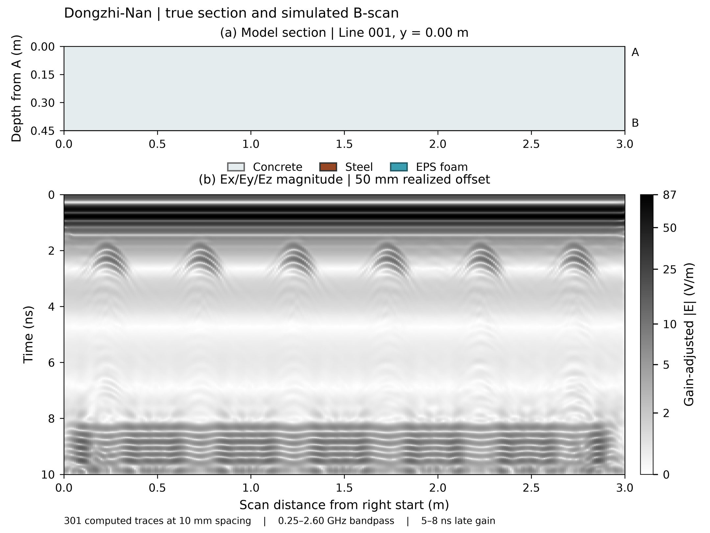

[PNG](line_001/section_and_synthetic.png) | [PDF](line_001/section_and_synthetic.pdf) | [Raw Ex](line_001/raw_Ex.jpg) | [Ex/Ey/Ez magnitude](line_001/synthetic_magnitude_gray.jpg)

## Line 002 — y = 0.10 m

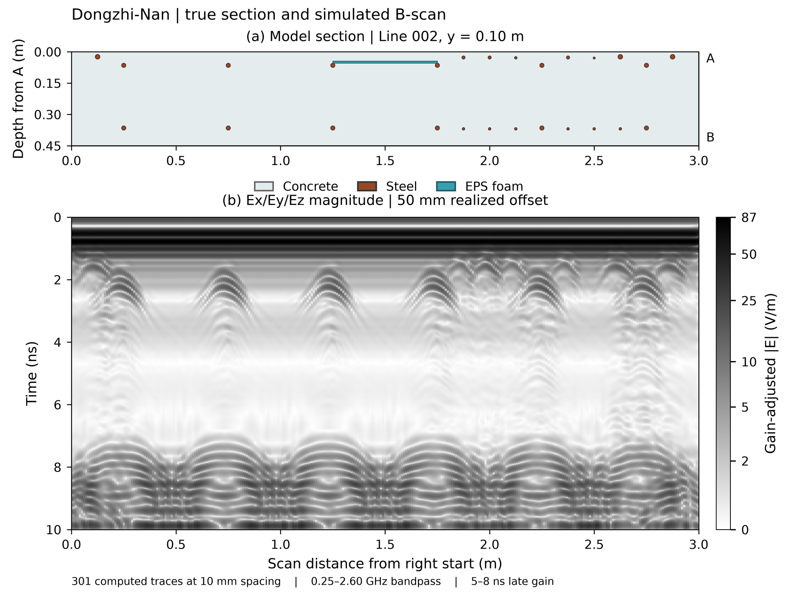

[PNG](line_002/section_and_synthetic.png) | [PDF](line_002/section_and_synthetic.pdf) | [Raw Ex](line_002/raw_Ex.jpg) | [Ex/Ey/Ez magnitude](line_002/synthetic_magnitude_gray.jpg)

## Line 003 — y = 0.20 m

[PNG](line_003/section_and_synthetic.png) | [PDF](line_003/section_and_synthetic.pdf) | [Raw Ex](line_003/raw_Ex.jpg) | [Ex/Ey/Ez magnitude](line_003/synthetic_magnitude_gray.jpg)

## Line 004 — y = 0.30 m

[PNG](line_004/section_and_synthetic.png) | [PDF](line_004/section_and_synthetic.pdf) | [Raw Ex](line_004/raw_Ex.jpg) | [Ex/Ey/Ez magnitude](line_004/synthetic_magnitude_gray.jpg)

## Line 005 — y = 0.40 m

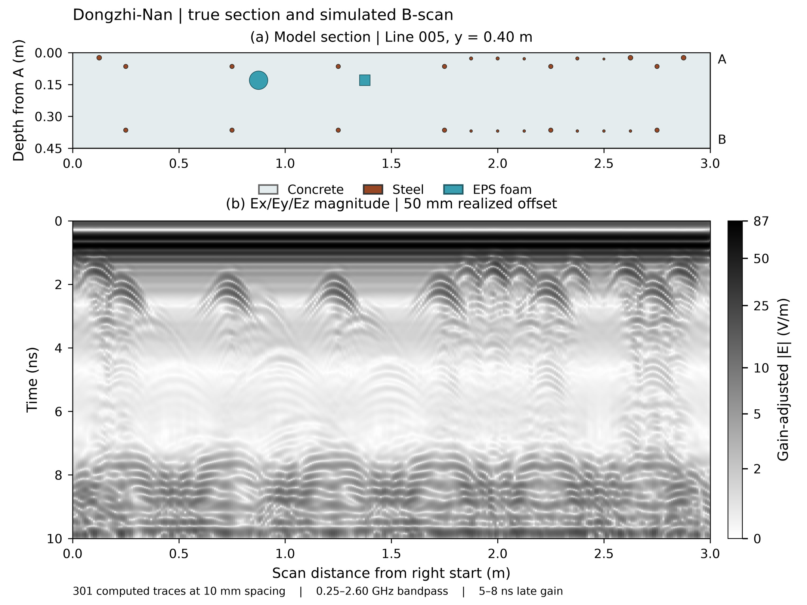

[PNG](line_005/section_and_synthetic.png) | [PDF](line_005/section_and_synthetic.pdf) | [Raw Ex](line_005/raw_Ex.jpg) | [Ex/Ey/Ez magnitude](line_005/synthetic_magnitude_gray.jpg)

## Line 006 — y = 0.50 m

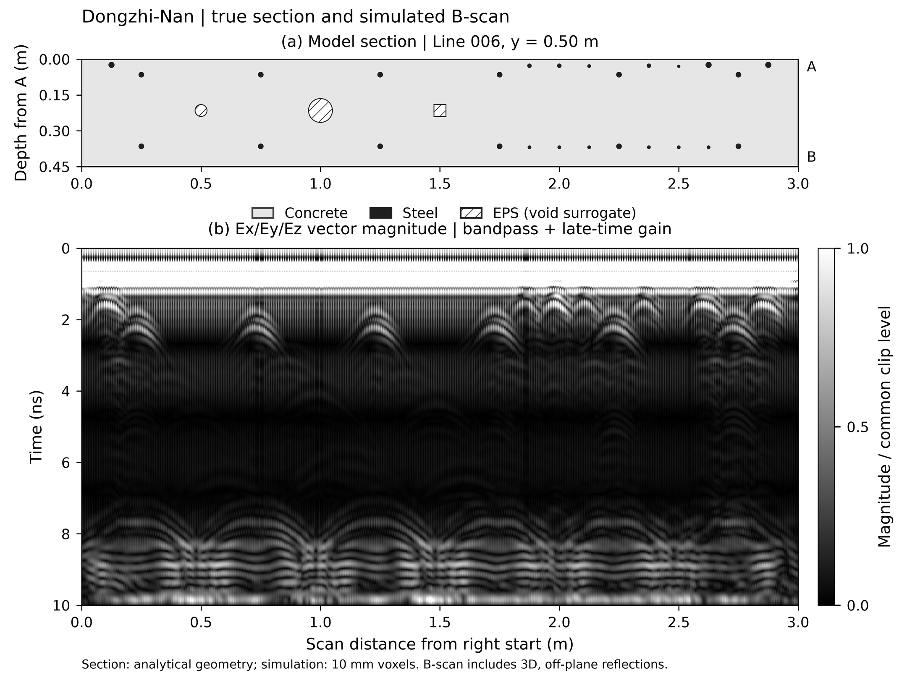

[PNG](line_006/section_and_synthetic.png) | [PDF](line_006/section_and_synthetic.pdf) | [Raw Ex](line_006/raw_Ex.jpg) | [Ex/Ey/Ez magnitude](line_006/synthetic_magnitude_gray.jpg)

## Line 007 — y = 0.60 m

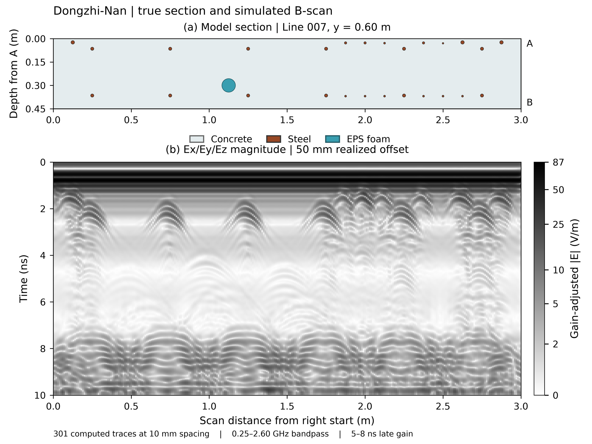

[PNG](line_007/section_and_synthetic.png) | [PDF](line_007/section_and_synthetic.pdf) | [Raw Ex](line_007/raw_Ex.jpg) | [Ex/Ey/Ez magnitude](line_007/synthetic_magnitude_gray.jpg)

## Line 008 — y = 0.70 m

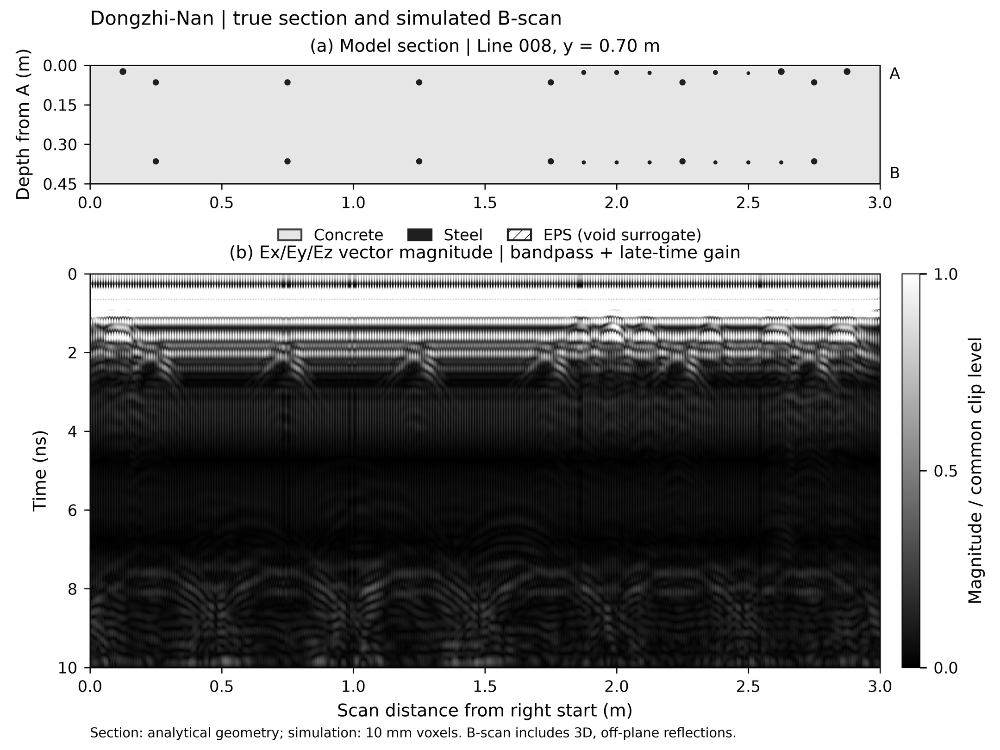

[PNG](line_008/section_and_synthetic.png) | [PDF](line_008/section_and_synthetic.pdf) | [Raw Ex](line_008/raw_Ex.jpg) | [Ex/Ey/Ez magnitude](line_008/synthetic_magnitude_gray.jpg)

## Line 009 — y = 0.80 m

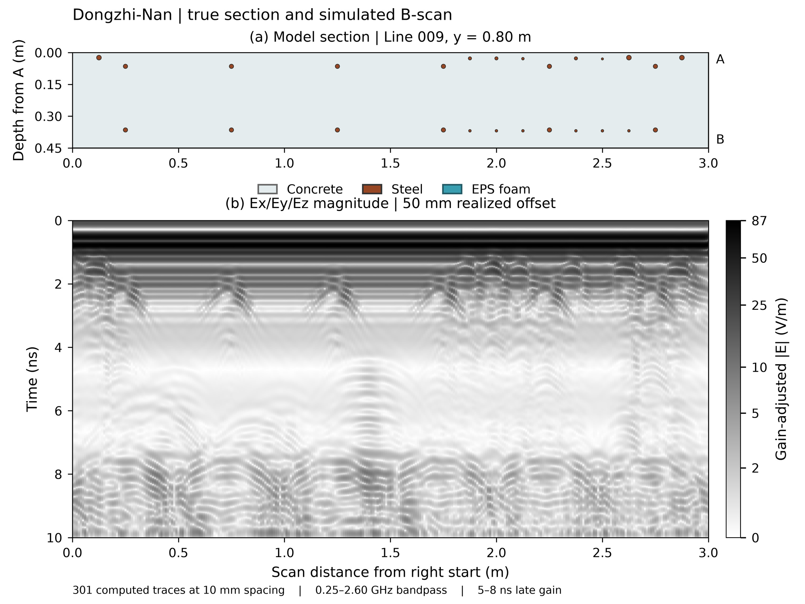

[PNG](line_009/section_and_synthetic.png) | [PDF](line_009/section_and_synthetic.pdf) | [Raw Ex](line_009/raw_Ex.jpg) | [Ex/Ey/Ez magnitude](line_009/synthetic_magnitude_gray.jpg)

## Line 010 — y = 0.90 m

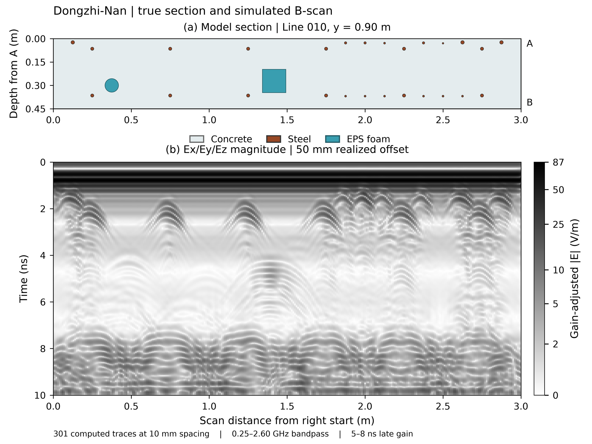

[PNG](line_010/section_and_synthetic.png) | [PDF](line_010/section_and_synthetic.pdf) | [Raw Ex](line_010/raw_Ex.jpg) | [Ex/Ey/Ez magnitude](line_010/synthetic_magnitude_gray.jpg)

## Line 011 — y = 1.00 m

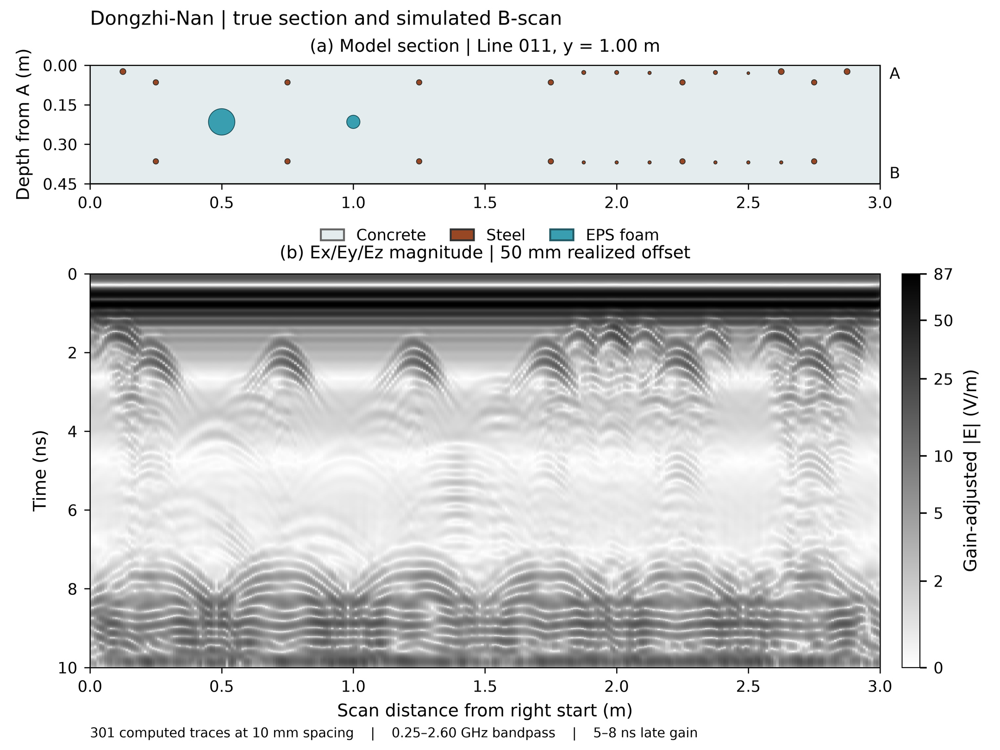

[PNG](line_011/section_and_synthetic.png) | [PDF](line_011/section_and_synthetic.pdf) | [Raw Ex](line_011/raw_Ex.jpg) | [Ex/Ey/Ez magnitude](line_011/synthetic_magnitude_gray.jpg)

## Line 012 — y = 1.10 m

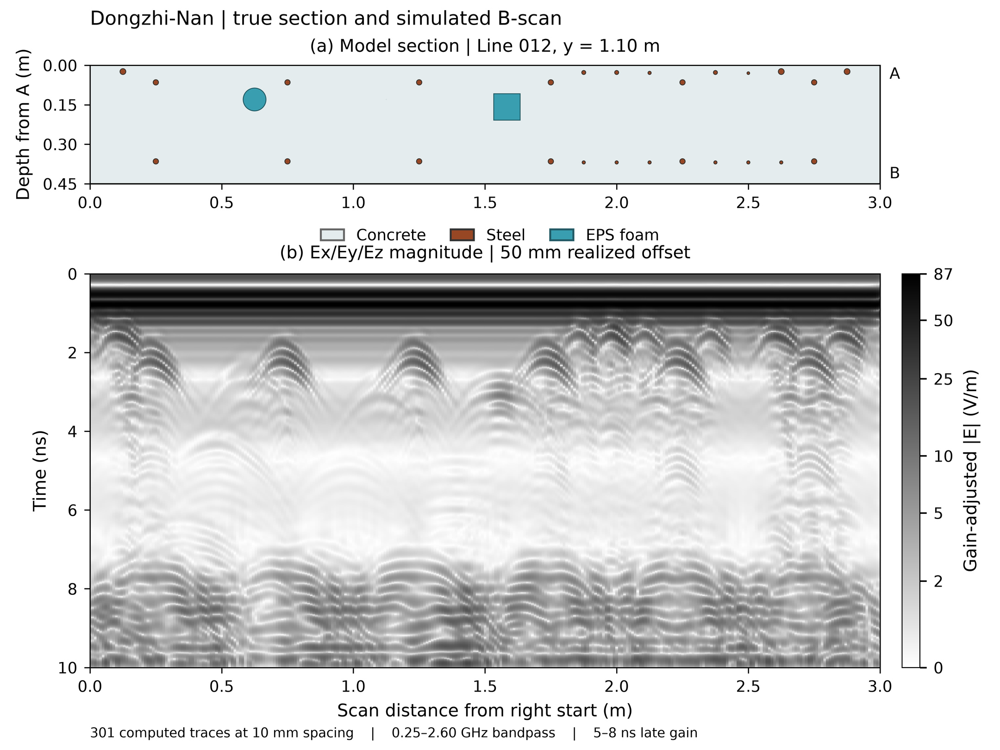

[PNG](line_012/section_and_synthetic.png) | [PDF](line_012/section_and_synthetic.pdf) | [Raw Ex](line_012/raw_Ex.jpg) | [Ex/Ey/Ez magnitude](line_012/synthetic_magnitude_gray.jpg)

## Line 013 — y = 1.20 m

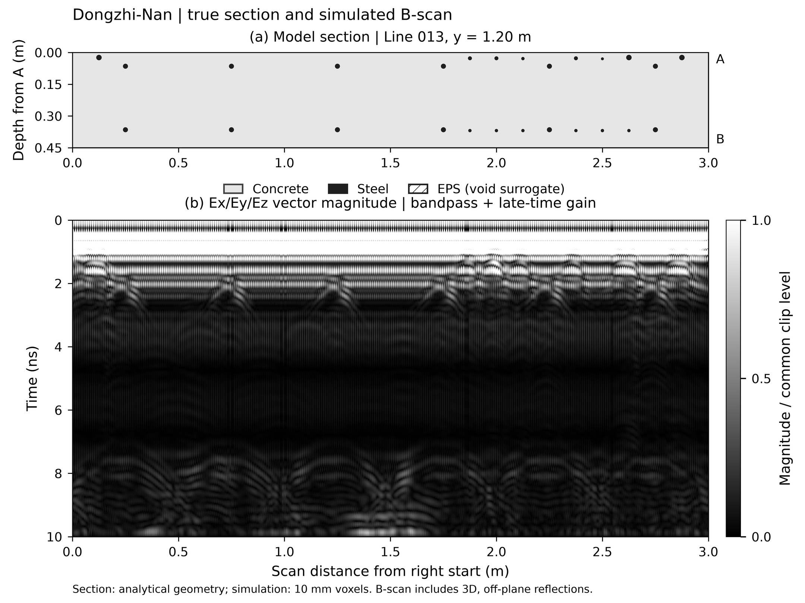

[PNG](line_013/section_and_synthetic.png) | [PDF](line_013/section_and_synthetic.pdf) | [Raw Ex](line_013/raw_Ex.jpg) | [Ex/Ey/Ez magnitude](line_013/synthetic_magnitude_gray.jpg)

## Line 014 — y = 1.30 m

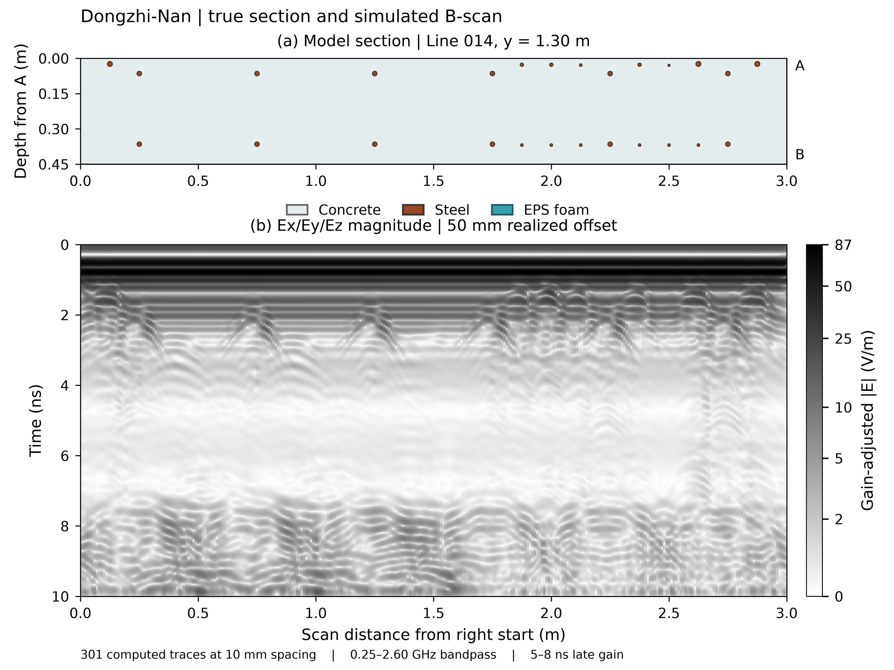

[PNG](line_014/section_and_synthetic.png) | [PDF](line_014/section_and_synthetic.pdf) | [Raw Ex](line_014/raw_Ex.jpg) | [Ex/Ey/Ez magnitude](line_014/synthetic_magnitude_gray.jpg)

## Line 015 — y = 1.40 m

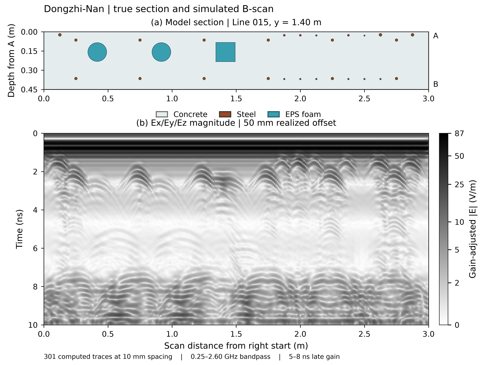

[PNG](line_015/section_and_synthetic.png) | [PDF](line_015/section_and_synthetic.pdf) | [Raw Ex](line_015/raw_Ex.jpg) | [Ex/Ey/Ez magnitude](line_015/synthetic_magnitude_gray.jpg)

## Line 016 — y = 1.50 m

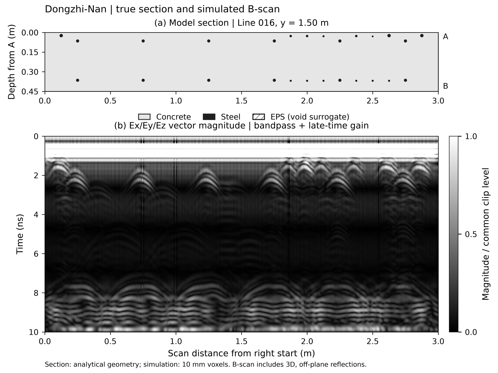

[PNG](line_016/section_and_synthetic.png) | [PDF](line_016/section_and_synthetic.pdf) | [Raw Ex](line_016/raw_Ex.jpg) | [Ex/Ey/Ez magnitude](line_016/synthetic_magnitude_gray.jpg)

## Line 017 — y = 1.60 m

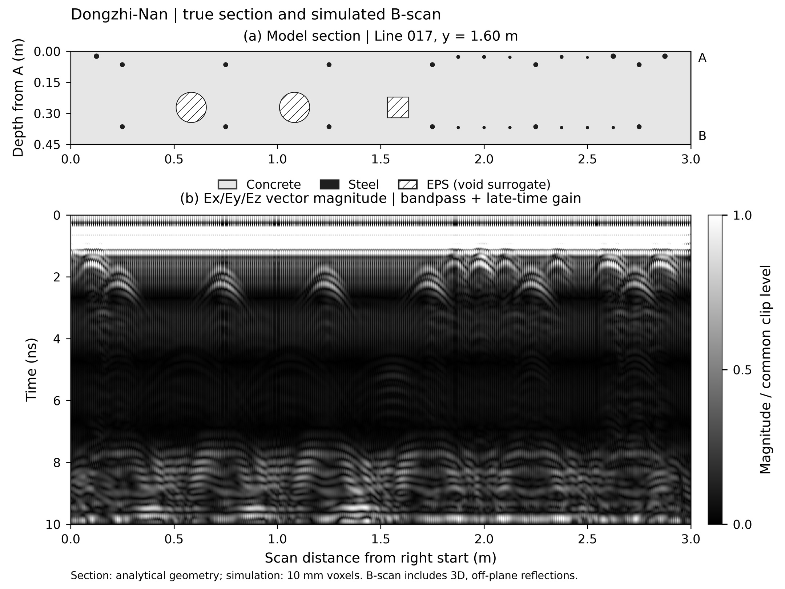

[PNG](line_017/section_and_synthetic.png) | [PDF](line_017/section_and_synthetic.pdf) | [Raw Ex](line_017/raw_Ex.jpg) | [Ex/Ey/Ez magnitude](line_017/synthetic_magnitude_gray.jpg)

## Line 018 — y = 1.70 m

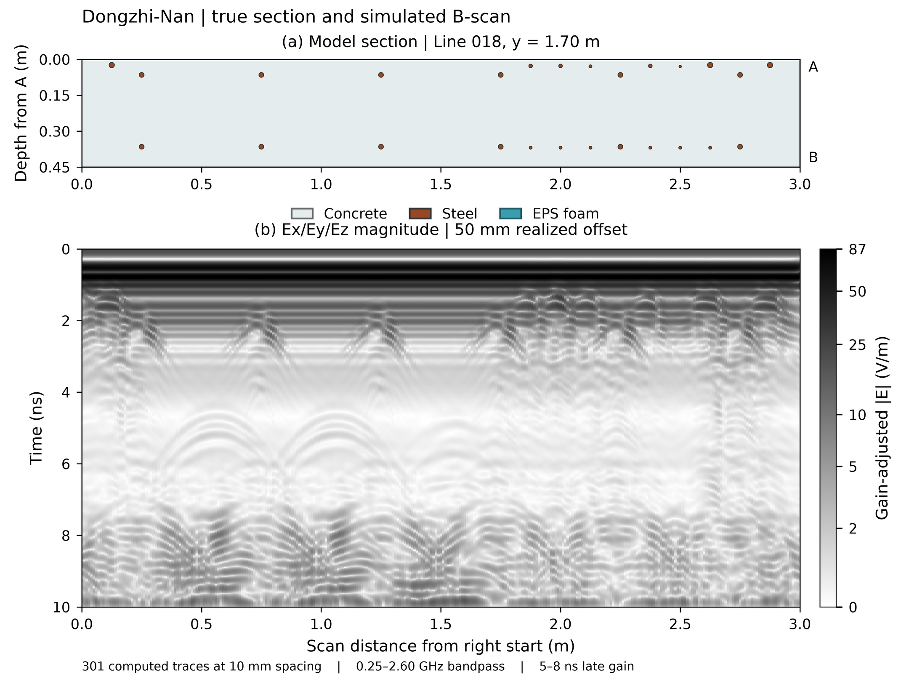

[PNG](line_018/section_and_synthetic.png) | [PDF](line_018/section_and_synthetic.pdf) | [Raw Ex](line_018/raw_Ex.jpg) | [Ex/Ey/Ez magnitude](line_018/synthetic_magnitude_gray.jpg)

## Line 019 — y = 1.80 m

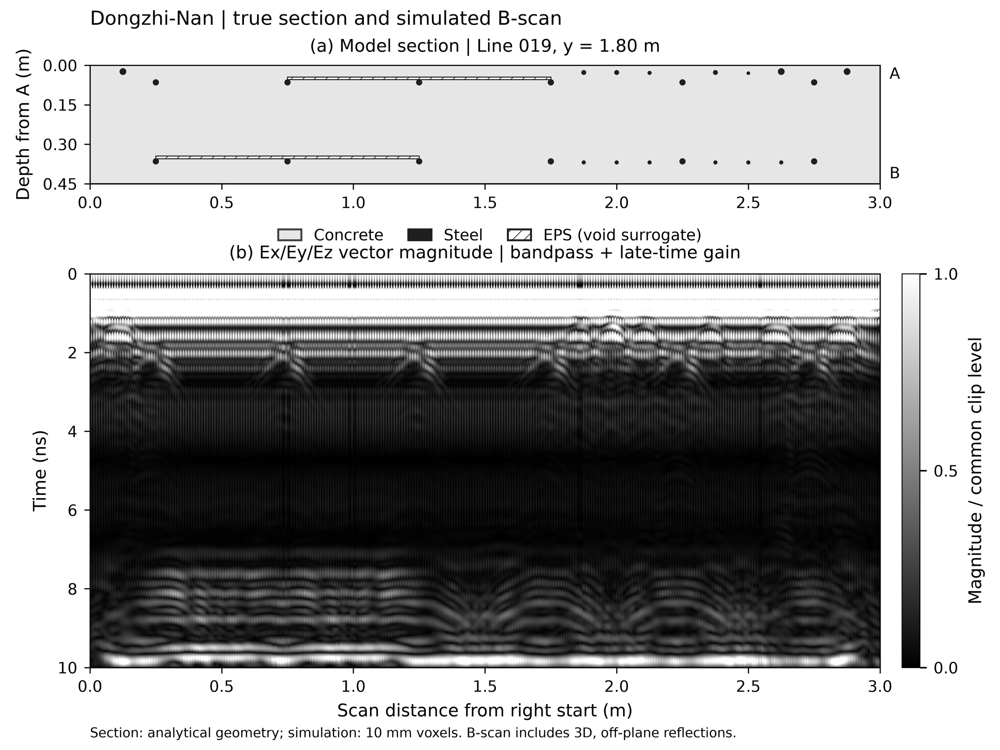

[PNG](line_019/section_and_synthetic.png) | [PDF](line_019/section_and_synthetic.pdf) | [Raw Ex](line_019/raw_Ex.jpg) | [Ex/Ey/Ez magnitude](line_019/synthetic_magnitude_gray.jpg)

## Line 020 — y = 1.90 m

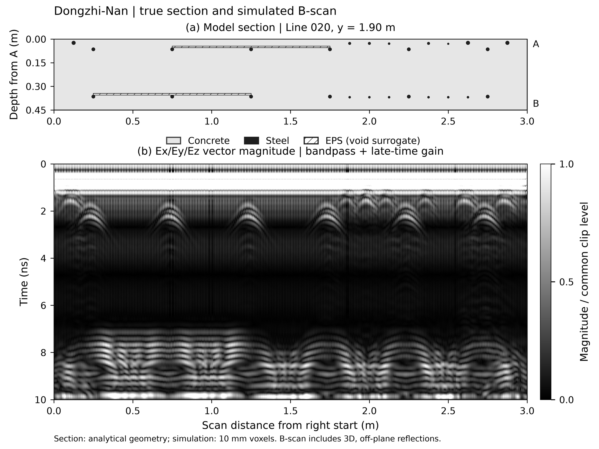

[PNG](line_020/section_and_synthetic.png) | [PDF](line_020/section_and_synthetic.pdf) | [Raw Ex](line_020/raw_Ex.jpg) | [Ex/Ey/Ez magnitude](line_020/synthetic_magnitude_gray.jpg)

## Line 021 — y = 2.00 m

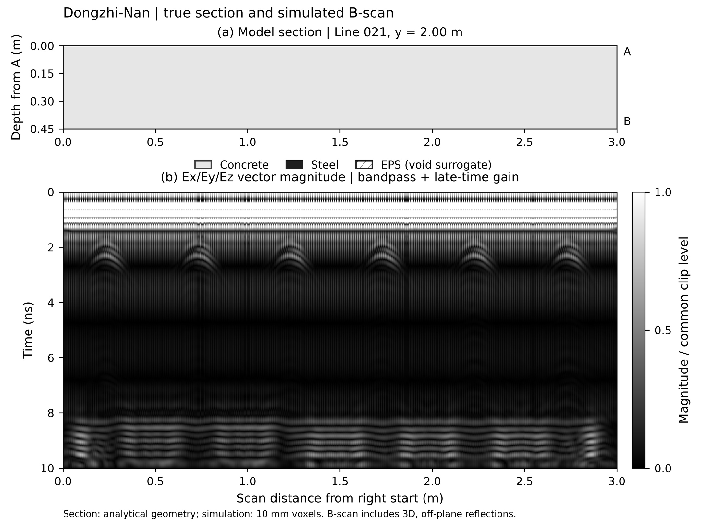

[PNG](line_021/section_and_synthetic.png) | [PDF](line_021/section_and_synthetic.pdf) | [Raw Ex](line_021/raw_Ex.jpg) | [Ex/Ey/Ez magnitude](line_021/synthetic_magnitude_gray.jpg)
