# 21 grayscale radargrams

These are signed-Ex figures regenerated from numerical gprMax outputs. PNG (600 dpi), PDF and JPG exports are available in each line directory.

## Line 001

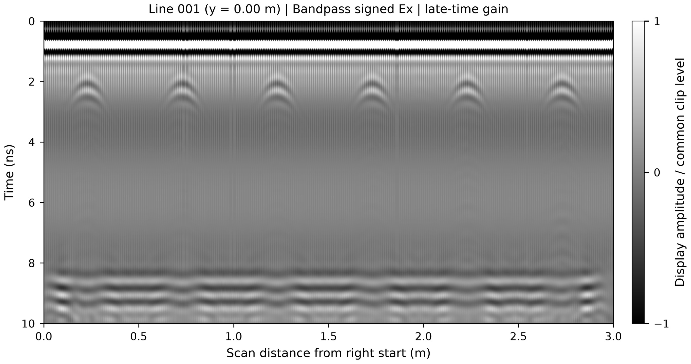

[PNG](line_001/grayscale_Ex_late_gain.png) | [PDF](line_001/grayscale_Ex_late_gain.pdf) | [Late detail](line_001/late_window_Ex.jpg)

## Line 002

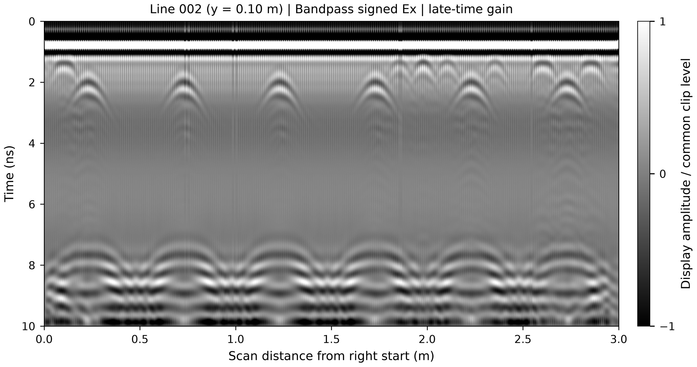

[PNG](line_002/grayscale_Ex_late_gain.png) | [PDF](line_002/grayscale_Ex_late_gain.pdf) | [Late detail](line_002/late_window_Ex.jpg)

## Line 003

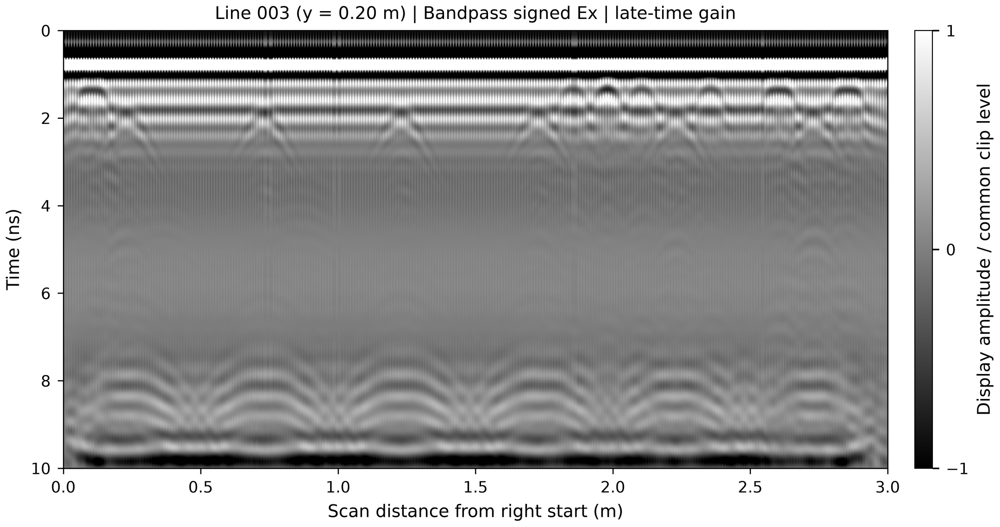

[PNG](line_003/grayscale_Ex_late_gain.png) | [PDF](line_003/grayscale_Ex_late_gain.pdf) | [Late detail](line_003/late_window_Ex.jpg)

## Line 004

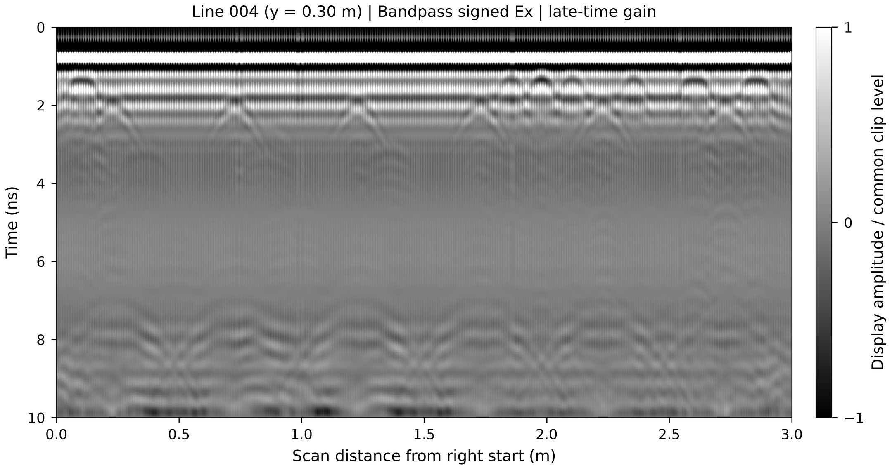

[PNG](line_004/grayscale_Ex_late_gain.png) | [PDF](line_004/grayscale_Ex_late_gain.pdf) | [Late detail](line_004/late_window_Ex.jpg)

## Line 005

[PNG](line_005/grayscale_Ex_late_gain.png) | [PDF](line_005/grayscale_Ex_late_gain.pdf) | [Late detail](line_005/late_window_Ex.jpg)

## Line 006

[PNG](line_006/grayscale_Ex_late_gain.png) | [PDF](line_006/grayscale_Ex_late_gain.pdf) | [Late detail](line_006/late_window_Ex.jpg)

## Line 007

[PNG](line_007/grayscale_Ex_late_gain.png) | [PDF](line_007/grayscale_Ex_late_gain.pdf) | [Late detail](line_007/late_window_Ex.jpg)

## Line 008

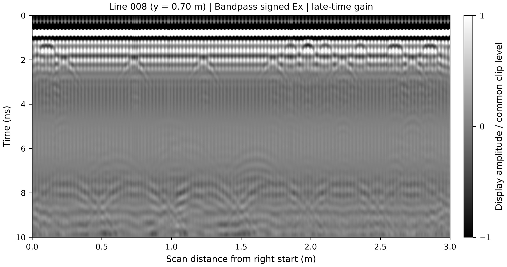

[PNG](line_008/grayscale_Ex_late_gain.png) | [PDF](line_008/grayscale_Ex_late_gain.pdf) | [Late detail](line_008/late_window_Ex.jpg)

## Line 009

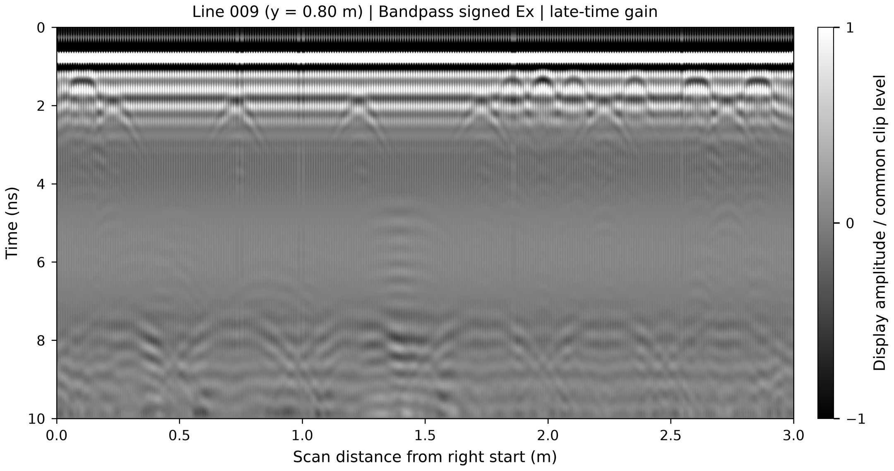

[PNG](line_009/grayscale_Ex_late_gain.png) | [PDF](line_009/grayscale_Ex_late_gain.pdf) | [Late detail](line_009/late_window_Ex.jpg)

## Line 010

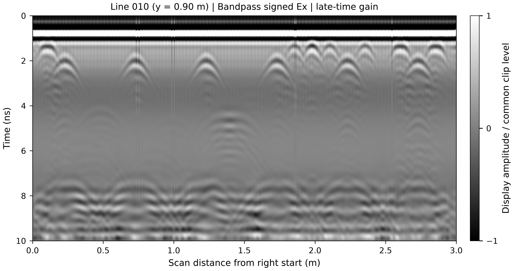

[PNG](line_010/grayscale_Ex_late_gain.png) | [PDF](line_010/grayscale_Ex_late_gain.pdf) | [Late detail](line_010/late_window_Ex.jpg)

## Line 011

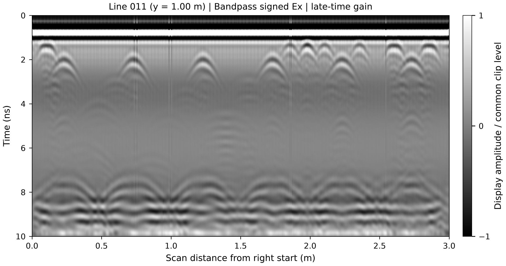

[PNG](line_011/grayscale_Ex_late_gain.png) | [PDF](line_011/grayscale_Ex_late_gain.pdf) | [Late detail](line_011/late_window_Ex.jpg)

## Line 012

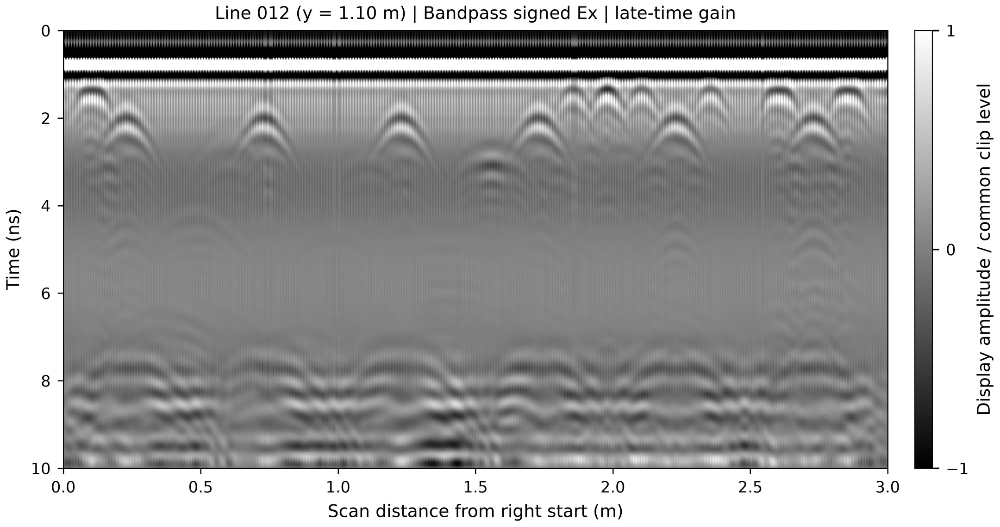

[PNG](line_012/grayscale_Ex_late_gain.png) | [PDF](line_012/grayscale_Ex_late_gain.pdf) | [Late detail](line_012/late_window_Ex.jpg)

## Line 013

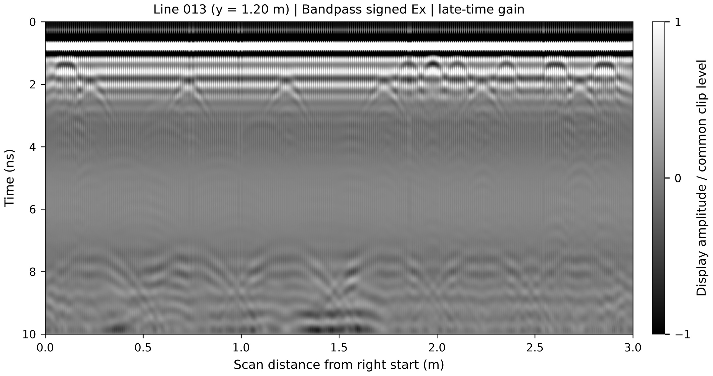

[PNG](line_013/grayscale_Ex_late_gain.png) | [PDF](line_013/grayscale_Ex_late_gain.pdf) | [Late detail](line_013/late_window_Ex.jpg)

## Line 014

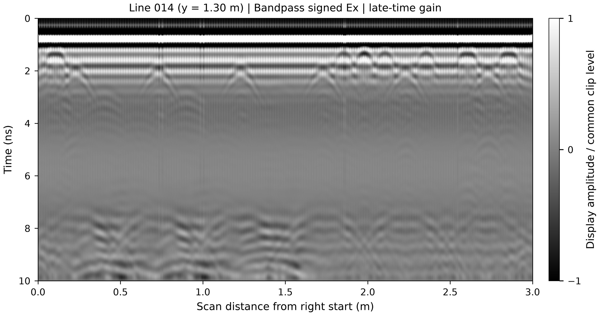

[PNG](line_014/grayscale_Ex_late_gain.png) | [PDF](line_014/grayscale_Ex_late_gain.pdf) | [Late detail](line_014/late_window_Ex.jpg)

## Line 015

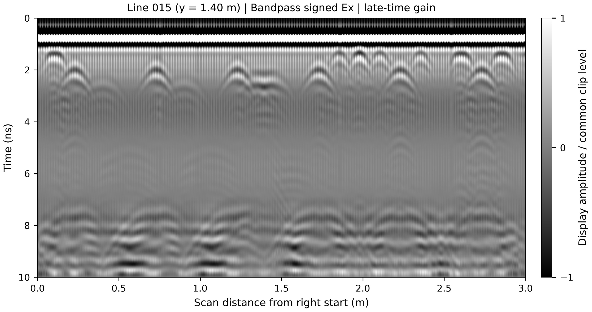

[PNG](line_015/grayscale_Ex_late_gain.png) | [PDF](line_015/grayscale_Ex_late_gain.pdf) | [Late detail](line_015/late_window_Ex.jpg)

## Line 016

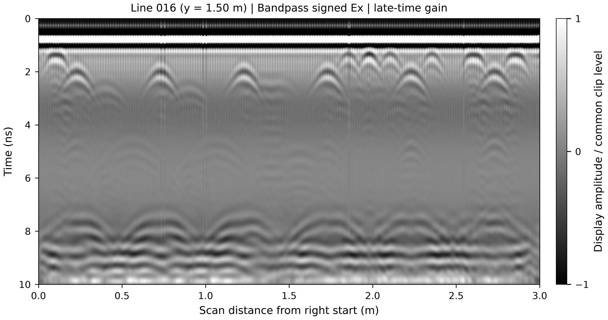

[PNG](line_016/grayscale_Ex_late_gain.png) | [PDF](line_016/grayscale_Ex_late_gain.pdf) | [Late detail](line_016/late_window_Ex.jpg)

## Line 017

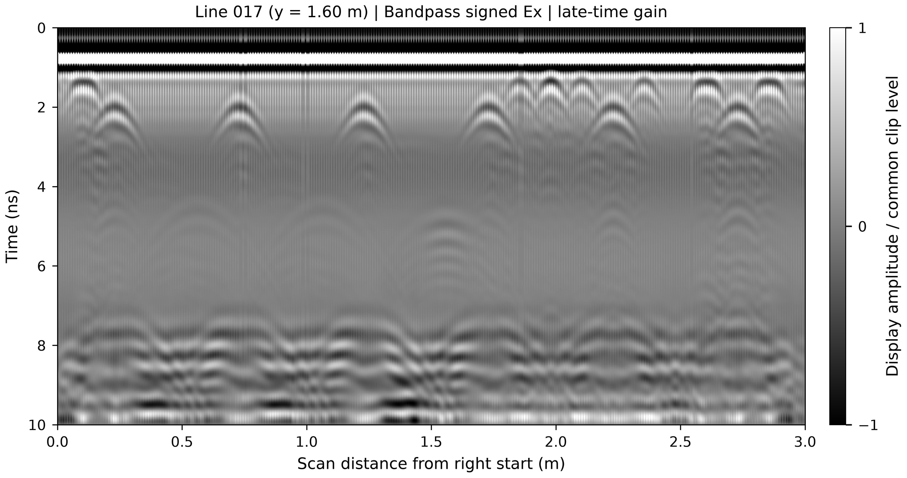

[PNG](line_017/grayscale_Ex_late_gain.png) | [PDF](line_017/grayscale_Ex_late_gain.pdf) | [Late detail](line_017/late_window_Ex.jpg)

## Line 018

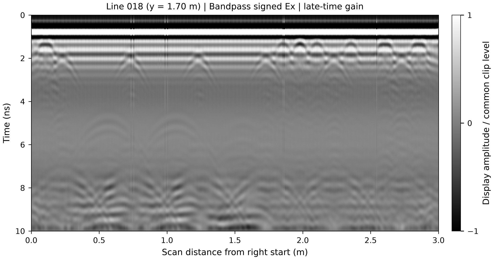

[PNG](line_018/grayscale_Ex_late_gain.png) | [PDF](line_018/grayscale_Ex_late_gain.pdf) | [Late detail](line_018/late_window_Ex.jpg)

## Line 019

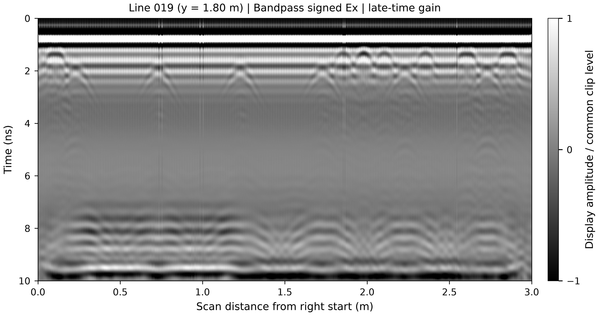

[PNG](line_019/grayscale_Ex_late_gain.png) | [PDF](line_019/grayscale_Ex_late_gain.pdf) | [Late detail](line_019/late_window_Ex.jpg)

## Line 020

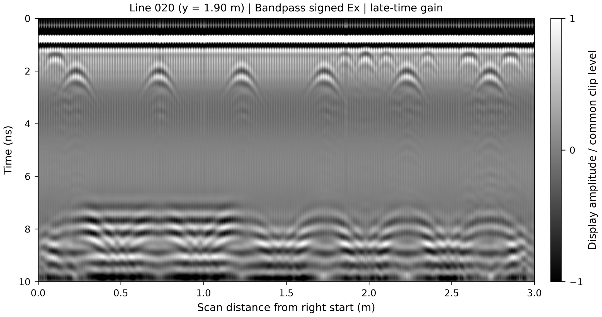

[PNG](line_020/grayscale_Ex_late_gain.png) | [PDF](line_020/grayscale_Ex_late_gain.pdf) | [Late detail](line_020/late_window_Ex.jpg)

## Line 021

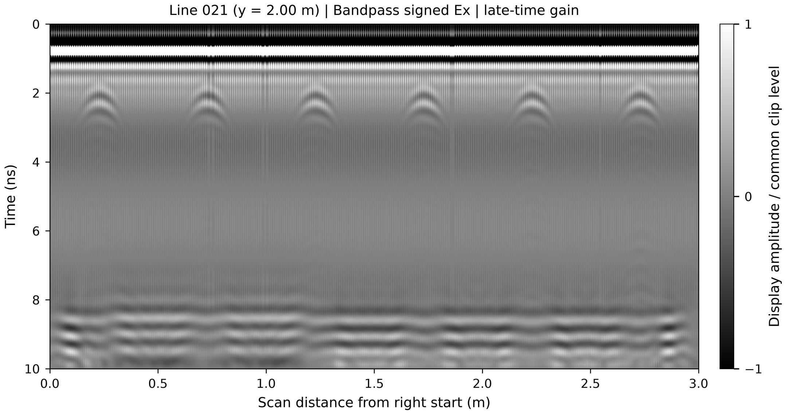

[PNG](line_021/grayscale_Ex_late_gain.png) | [PDF](line_021/grayscale_Ex_late_gain.pdf) | [Late detail](line_021/late_window_Ex.jpg)

